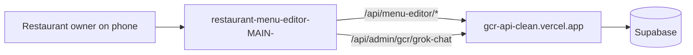

# restaurant-menu-editor-MAIN-

A phone-friendly Next.js page where a restaurant owner signs in with a slug and PIN and edits their menu, photos, hours, specials, availability and staff numbers.

## What it is

An owner-facing editor with no database of its own. Everything is read and written through the gcr-api-clean server's `/api/menu-editor/*` routes; this repo is only the screen.

## How it works

- Next.js 14 (pages router), React 18. `pages/index.js` is the editor (about 2,400 lines); `pages/[slug].js` reuses it for a per-restaurant URL; `pages/new.js` is a "create a menu" form.
- API host: `NEXT_PUBLIC_API_URL`, default `https://gcr-api-clean.vercel.app`.
- Sign-in: `POST /api/menu-editor/:slug/auth` with the PIN returns a token, sent as the `x-menu-token` header on later calls.
- Other calls under `/api/menu-editor/`: `:slug/data`, `:slug/save`, `:slug/upload`, `:slug/set-hero`, `:slug/availability` (and `/:id`), `:slug/fuel`, `:slug/staff` (and `/:id`), and `create`. An AI helper calls `/api/admin/gcr/grok-chat`.
- `pages/api/upload.js` is a small proxy: it parses an image with formidable and forwards it to the same API's upload route (host from `NEXT_PUBLIC_GCR_API`, default the same URL). `pages/api/data.js` returns 410 (deprecated).
- Leftovers: `pages/index-hardcoded-demo.js` (older demo pointing at localhost:3001), `scripts/seed-menu.js` (needs `@vercel/blob`, which is not in `package.json`), `scripts/gulfislandgrill.json` (sample menu), and several ad-hoc Playwright scripts in the root and `tests/`.

## Run it

```bash
npm install
npm run dev      # http://localhost:3000
npm run build && npm start
```

Optional variables: `NEXT_PUBLIC_API_URL`, `NEXT_PUBLIC_GCR_API`. It is only useful while the target API's menu-editor routes are live. Not run while writing this README.

## Status

In use: the owner-facing menu editor for the current gcr-api-clean back end.

## Where it fits



## Related repos

- gcr-api-clean: the server behind every call.
- cybercheck-api-database: older equivalents (`routes/menu-edit.js`, `simple-menu-edit.js`, `update-link.js`) that this replaces.
- admin-dashboard-: a more general editor over the same business data, writing to tables directly.
